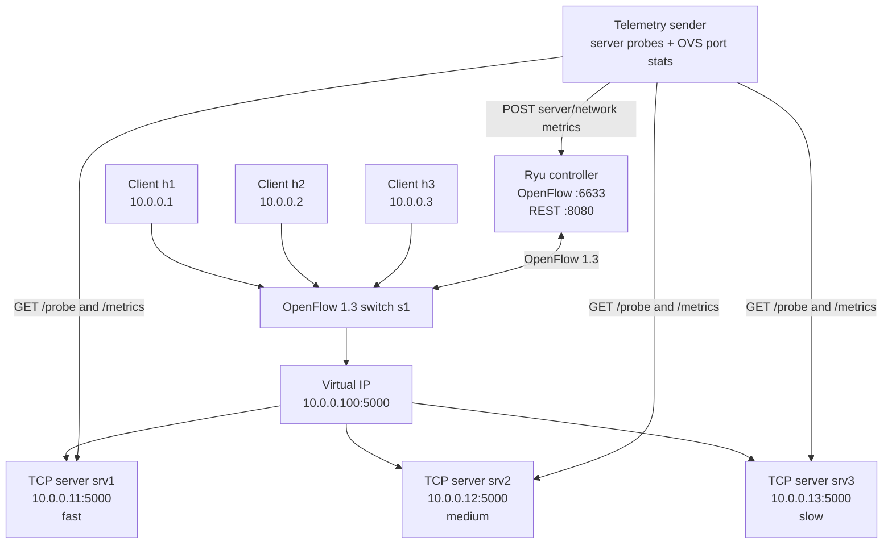

# SDN Adaptive Load Balancing Using Ryu, Mininet and TCP Sockets

**GitHub repository:** https://github.com/abhiram132007-debug/SDN-Adaptive-Load-Balancing

This repository contains an SDN-based TCP load balancer. Clients connect to one Virtual IP (VIP), `10.0.0.100`. The Ryu controller chooses one of three TCP application servers and installs OpenFlow 1.3 rules on the Mininet switch.

The project provides two runtime strategies:

- **Round Robin:** sends each new TCP connection to the next server in sequence. This is the baseline strategy.
- **Adaptive:** chooses among healthy servers using a score based on active connections, latency, CPU utilisation and network-link utilisation.

A separate telemetry sender collects server and switch measurements and sends them to the controller's REST API. In Adaptive mode, unavailable or overloaded servers are excluded from **new** VIP connections. When a server becomes healthy again, it can be selected again.

> These instructions are written for a new Ubuntu/Mininet user. Run the terminals in the order shown. Do not run Mininet commands such as `h1 ...` in a normal Ubuntu shell; those commands belong at the `mininet>` prompt.

---
##  Project 20. Team members

**Team 15**

| SRN | Name |
|---|---|
| PES2UG25CS020 | Abhiram Bendi |
| PES2UG25CS012 | Aaryaansh Mishra |
| PES2UG25CS063 | Anagha KP Bhat |

## 1. Project requirements and features

| Project requirement | How this project implements it |
|---|---|
| Multiple TCP application servers | Three threaded TCP servers: `srv1`, `srv2`, `srv3` |
| Concurrent client requests | `client.py` creates concurrent client threads; tests were run with 10, 25 and 50 clients |
| Server-load monitoring | Telemetry collects CPU, memory, active TCP connections and response latency |
| Network-load monitoring | Telemetry reads Open vSwitch port counters and calculates RX/TX Mbps |
| SDN-based flow distribution | Ryu installs OpenFlow 1.3 forwarding and address-rewrite rules |
| Overloaded-server detection | Controller checks CPU, latency and active connections; Adaptive excludes overloaded servers from new VIP connections |
| Server-failure detection | Telemetry reports failed probes/stale servers; Adaptive excludes unavailable servers |
| Recovery | After telemetry reports a recovered server as UP, Adaptive can select it again |

## 2. Architecture



### Address and port plan

| Component | Address / port | Purpose |
|---|---|---|
| Ryu OpenFlow listener | `127.0.0.1:6633` | Mininet switch connection |
| Ryu REST API | `127.0.0.1:8080` | Mode, configuration, state and telemetry endpoints |
| VIP | `10.0.0.100:5000` | Address used by clients |
| `srv1` | `10.0.0.11:5000` | Fast backend; configured delay 0.05 s |
| `srv2` | `10.0.0.12:5000` | Medium backend; configured delay 0.20 s |
| `srv3` | `10.0.0.13:5000` | Slow backend; configured delay 0.50 s |
| Mininet switch | `s1` | OpenFlow 1.3 switch |
| Telemetry/root interface | `10.0.0.254/8` | Host-side access to Mininet servers and controller REST API |

Switch port mapping: `h1=1`, `h2=2`, `h3=3`, `srv1=4`, `srv2=5`, `srv3=6`, root/telemetry interface `=7`. These values must remain consistent with `source/topography.py` and `source/lb_controller.py`.

## 3. Repository layout

```text
SDN-Adaptive-Load-Balancing/
├── README.md
├── .gitignore
├── source/
│   ├── client.py
│   ├── server.py
│   ├── lb_controller.py
│   ├── topography.py
│   ├── telemetry_sender.py
│   └── plot_results.py
├── results/
│   ├── perf_results.jsonl
│   ├── results.jsonl
│   └── ovs_port_stats.txt
├── graphs/
│   ├── average_latency.png
│   ├── p95_latency.png
│   ├── throughput.png
│   └── server_distribution.png
└── docs/
    ├── test_cases.md
    └── DEMO_GUIDE.md
```

## 4. Software prerequisites

The tested environment used:

- Ubuntu Linux
- Ryu 4.34 running in Python 3.9.25 virtual environment
- Mininet 2.3.0
- Open vSwitch 3.7.1 with OpenFlow 1.3 support
- Python `psutil` for server process metrics
- `curl` for REST API checks

Install the Ubuntu networking dependencies:

```bash
sudo apt update
sudo apt install -y mininet openvswitch-switch python3-psutil python3-pip python3-venv curl
sudo systemctl enable --now openvswitch-switch
```

Check the tools:

```bash
python3 --version
mn --version
ovs-vsctl --version
ovs-ofctl --version
python3 -c "import psutil; print('psutil OK:', psutil.__version__)"
```

The Ryu 4.34 environment used Python 3.9. Confirm that Python 3.9 is available:

```bash
python3.9 --version
```

If `python3.9` is not installed, install/provide Python 3.9 for your Ubuntu release before continuing. Ryu 4.34 is an older release; the tested setup used Python 3.9 rather than the system's newer Python.

## 5. Download the project

Open an Ubuntu terminal and run:

```bash
git clone https://github.com/abhiram132007-debug/SDN-Adaptive-Load-Balancing.git
cd SDN-Adaptive-Load-Balancing
```

Keep this repository root as the working directory for the commands below. The source files are inside `source/`.

## 6. Create the Ryu Python environment (one-time setup)

Run these commands once on a new Ubuntu installation:

```bash
python3.9 -m venv ~/ryu-env
source ~/ryu-env/bin/activate
python -m pip install --upgrade "pip<25.3" "setuptools<58" wheel
python -m pip install --no-build-isolation "ryu==4.34" "eventlet<0.30.3"
ryu-manager --version
```

Expected version: `ryu-manager 4.34`.

Keep Ryu in its own virtual environment. Mininet, the topology and the TCP servers use the system `python3` environment, which must be able to import `mininet` and `psutil`.

## 7. Start the complete project (three terminals)

**Important: Start Ryu first, Mininet second, and telemetry third.** Leave each terminal open while demonstrating the project.

### Terminal 1 — Start the Ryu controller

From the repository root:

```bash
cd ~/SDN-Adaptive-Load-Balancing
source ~/ryu-env/bin/activate
ryu-manager --verbose source/lb_controller.py
```

Wait for a message similar to:

```text
wsgi starting up on http://0.0.0.0:8080
```

Ryu listens for the switch on TCP port `6633` and provides its REST API on port `8080`. Keep this terminal running.

### Terminal 2 — Start Mininet and the TCP servers

Open a second terminal:

```bash
cd ~/SDN-Adaptive-Load-Balancing
sudo mn -c
sudo python3 source/topography.py
```

`topography.py` creates the remote controller connection, OpenFlow 1.3 switch `s1`, three clients and three servers. It starts the three TCP server processes automatically.

Wait for the `mininet>` prompt. Then, inside Mininet, run:

```text
nodes
net
pingall
```

Expected nodes:

```text
c0 h1 h2 h3 s1 srv1 srv2 srv3
```

Expected connectivity result from the tested topology:

```text
0% dropped (30/30 received)
```

Keep this terminal at the `mininet>` prompt. **Commands beginning with `h1`, `h2`, `h3` or `srv1`/`srv2`/`srv3` must be entered here, not in a normal Ubuntu prompt.**

### Terminal 3 — Start monitoring and telemetry

Open a third normal Ubuntu terminal:

```bash
cd ~/SDN-Adaptive-Load-Balancing
sudo python3 source/telemetry_sender.py --interval 1 --log /tmp/telemetry_log.jsonl
```

The sender polls each server's `/probe` and `/metrics` endpoints and reads Open vSwitch port statistics. It posts server and network measurements to Ryu's REST API. Expected output looks similar to:

```text
Telemetry sender started -> http://127.0.0.1:8080
server1 UP lat=... cpu=... conns=...
server2 UP lat=... cpu=... conns=...
server3 UP lat=... cpu=... conns=...
```

Keep this terminal running during the demonstration.

## 8. Verify that the integrated system is running

In a fourth normal Ubuntu terminal:

```bash
curl -s http://127.0.0.1:8080/state | python3 -m json.tool
```

Check that:

- `mode` is `round_robin` or `adaptive`.
- All three server entries show `UP` when their processes are running.
- `cpu`, `mem_mb`, `latency_ema_ms` and `telemetry_age_s` have values after telemetry has run for a few seconds.
- `network` contains switch-port measurements.

Check the listening ports if needed:

```bash
sudo ss -ltnp | grep -E ':(6633|8080)\b'
```

## 9. Run the two load-balancing modes

These mode commands are entered in a **normal Ubuntu terminal**. Client commands are entered at the **Mininet `mininet>` prompt**.

### A. Round Robin mode

Normal Ubuntu terminal:

```bash
curl -X POST http://127.0.0.1:8080/mode \
  -H "Content-Type: application/json" \
  -d '{"mode":"round_robin"}'
```

Mininet terminal:

```text
h1 python3 source/client.py --clients 20 --requests 1
```

The client output includes successful/failed requests, average latency, P95 latency, maximum latency, throughput and `per_server` distribution.

### B. Adaptive mode

Normal Ubuntu terminal:

```bash
curl -X POST http://127.0.0.1:8080/mode \
  -H "Content-Type: application/json" \
  -d '{"mode":"adaptive"}'
```

Mininet terminal:

```text
h1 python3 source/client.py --clients 20 --requests 1
```

Adaptive selects the healthy server with the lowest calculated score. The score combines active connections, latency, CPU and network-link utilisation. Lower scores are preferred.

### C. Send application traffic from all three Mininet clients

At the `mininet>` prompt, run each command:

```text
h1 python3 source/client.py --clients 10 --requests 2 --label h1_test
h2 python3 source/client.py --clients 10 --requests 2 --label h2_test
h3 python3 source/client.py --clients 10 --requests 2 --label h3_test
```

This demonstrates that all three client nodes can send application requests to the VIP.

## 10. Demonstrate overloaded-server detection (Adaptive mode)

This test deliberately creates sustained direct TCP activity on Server 2. It is separate from VIP traffic: `--target 10.0.0.12` sends test requests directly to Server 2 so the server's reported active-connection metric rises.

1. Set Adaptive mode in a normal Ubuntu terminal:

```bash
curl -X POST http://127.0.0.1:8080/mode \
  -H "Content-Type: application/json" \
  -d '{"mode":"adaptive"}'
```

2. For a quick classroom demonstration, temporarily lower the active-connection threshold to 3. This is a **temporary test setting**, not the normal default (the controller default is 30):

```bash
curl -X POST http://127.0.0.1:8080/config \
  -H "Content-Type: application/json" \
  -d '{"conn_high":3}'
```

3. At the `mininet>` prompt, start sustained direct load in the background:

```text
h1 python3 source/client.py --target 10.0.0.12 --clients 40 --requests 100 --gap 0.05 --timeout 10 > /tmp/srv2_overload_test.txt 2>&1 &
```

4. While that load is still running, use a normal Ubuntu terminal to inspect controller state:

```bash
curl -s http://127.0.0.1:8080/state | python3 -c "import json,sys; d=json.load(sys.stdin); [print(s['name'], 'STATUS:', s['status'], 'ACTIVE:', s['active_flows'], 'CPU:', s['cpu']) for s in d['servers']]"
```

Expected during the test: `server2 STATUS: OVERLOADED`, with its active count above the configured threshold.

5. While Server 2 is still overloaded, send new requests through the VIP from the Mininet prompt:

```text
h1 python3 source/client.py --clients 20 --requests 1 --label overload_exclusion
```

Expected: requests succeed and the `per_server` result contains Server 1 and Server 3; Server 2 should receive zero new VIP requests (it may be absent from the `per_server` dictionary when its count is zero).

6. Stop the direct background load from the Mininet prompt after capturing the test:

```text
h1 pkill -f "client.py --target 10.0.0.12"
```

7. Wait for telemetry to show Server 2 has returned to `UP`. Restore the normal threshold in a normal Ubuntu terminal:

```bash
curl -X POST http://127.0.0.1:8080/config \
  -H "Content-Type: application/json" \
  -d '{"conn_high":30}'
```

Confirm the final status with the `/state` command. Do not leave the temporary threshold at 3 after the demonstration.

## 11. Demonstrate server-failure detection and recovery

Keep Adaptive mode enabled and telemetry running.

1. At the `mininet>` prompt, stop Server 2:

```text
srv2 pkill -f "server.py --name srv2"
```

2. In a normal Ubuntu terminal, inspect state:

```bash
curl -s http://127.0.0.1:8080/state | python3 -m json.tool
```

After the next telemetry poll, Server 2 should report `DOWN`.

3. While Server 2 is down, run through the VIP from Mininet:

```text
h1 python3 source/client.py --clients 20 --requests 1 --label server2_down
```

Expected: new connections go to healthy servers, and Server 2 receives no new connections.

4. Restart Server 2 from the Mininet prompt. The topology's server script is in the repository's `source/` directory. From a Mininet prompt whose working directory is the repository root, run:

```text
srv2 python3 "$(pwd)/source/server.py" --name srv2 --delay 0.20 > /tmp/srv2.log 2>&1 &
```

5. Wait for telemetry to report Server 2 as `UP` again:

```bash
curl -s http://127.0.0.1:8080/state | python3 -m json.tool
```

6. Send another VIP client test. Server 2 should be eligible for new Adaptive connections again:

```text
h1 python3 source/client.py --clients 20 --requests 1 --label server2_recovered
```

## 12. Repeat the six performance experiments

The repository includes the measured six-run results in `results/perf_results.jsonl`. To repeat the same test design, use 5 requests per client at 10, 25 and 50 concurrent clients.

First, in a normal Ubuntu terminal, clear only the new temporary results file:

```bash
cd ~/SDN-Adaptive-Load-Balancing
rm -f /tmp/perf_results.jsonl
```

For each experiment, set the mode in a normal Ubuntu terminal, then run the matching client command at `mininet>`.

**Round Robin:**

```bash
curl -X POST http://127.0.0.1:8080/reset
curl -X POST http://127.0.0.1:8080/mode -H "Content-Type: application/json" -d '{"mode":"round_robin"}'
```

```text
h1 python3 source/client.py --clients 10 --requests 5 --out /tmp/perf_results.jsonl --label rr_10
h1 python3 source/client.py --clients 25 --requests 5 --out /tmp/perf_results.jsonl --label rr_25
h1 python3 source/client.py --clients 50 --requests 5 --out /tmp/perf_results.jsonl --label rr_50
```

**Adaptive:**

```bash
curl -X POST http://127.0.0.1:8080/reset
curl -X POST http://127.0.0.1:8080/mode -H "Content-Type: application/json" -d '{"mode":"adaptive"}'
```

```text
h1 python3 source/client.py --clients 10 --requests 5 --out /tmp/perf_results.jsonl --label adaptive_10
h1 python3 source/client.py --clients 25 --requests 5 --out /tmp/perf_results.jsonl --label adaptive_25
h1 python3 source/client.py --clients 50 --requests 5 --out /tmp/perf_results.jsonl --label adaptive_50
```

After all six runs, return to a normal Ubuntu terminal and copy the newly generated results into the repository (this replaces the previous repeat-run file):

```bash
cp /tmp/perf_results.jsonl results/perf_results.jsonl
```

The included results are one set of observed runs. New machines may produce different latency and throughput values because hardware and background load differ.

## 13. Regenerate the four performance graphs (optional)

Create a graph environment once:

```bash
python3.11 -m venv ~/graph-env
source ~/graph-env/bin/activate
python -m pip install matplotlib numpy
```

From the repository root, after `results/perf_results.jsonl` contains the six labels shown above, run:

```bash
python source/plot_results.py
```

The script writes the four PNG files to `graphs/`.

## 14. Capture network port statistics

With Mininet running, use a normal Ubuntu terminal:

```bash
sudo ovs-ofctl -O OpenFlow13 dump-ports s1 | tee results/ovs_port_stats.txt
```

The file records per-port packet, byte, drop and error counters. The provided snapshot showed zero RX/TX drops and errors on the reported switch ports for that test interval. Counters are cumulative since the switch started; take a new snapshot after a clean run if needed.

## 15. REST API reference

| Method | Endpoint | Purpose |
|---|---|---|
| GET | `/state` | Current mode, VIP, server health, scores, metrics, network data and configuration |
| POST | `/mode` | Select `round_robin` or `adaptive` |
| POST | `/metrics/server` | Receive server status, CPU, memory, active connections and latency |
| POST | `/metrics/network` | Receive per-port RX/TX Mbps |
| POST | `/config` | Update thresholds and weights |
| POST | `/reset` | Clear connection mappings, flow entries and assignment counters |

Examples:

```bash
curl -s http://127.0.0.1:8080/state | python3 -m json.tool
curl -X POST http://127.0.0.1:8080/mode -H "Content-Type: application/json" -d '{"mode":"adaptive"}'
curl -X POST http://127.0.0.1:8080/config -H "Content-Type: application/json" -d '{"conn_high":30}'
```

## 16. Recorded performance results

The checked-in measurements were obtained with 5 requests per client thread. These are observed single-run results, not guaranteed benchmarks for every machine.

| Concurrent clients | Strategy | Requests | Successful | Failed | Average latency (ms) | P95 latency (ms) | Throughput (requests/s) |
|---:|---|---:|---:|---:|---:|---:|---:|
| 10 | Round Robin | 50 | 50 | 0 | 347.7 | 853.2 | 19.56 |
| 10 | Adaptive | 50 | 50 | 0 | 310.1 | 804.7 | 22.39 |
| 25 | Round Robin | 125 | 125 | 0 | 501.0 | 1356.2 | 30.64 |
| 25 | Adaptive | 125 | 125 | 0 | 452.1 | 1354.6 | 35.14 |
| 50 | Round Robin | 250 | 250 | 0 | 751.8 | 2254.6 | 39.09 |
| 50 | Adaptive | 250 | 250 | 0 | 642.6 | 2054.6 | 44.86 |

The four graphs are stored in `graphs/`: average latency, P95 latency, throughput and server request distribution.

## 17. Troubleshooting

**`Unable to contact the remote controller at 127.0.0.1:6633`**

- Start Ryu first and wait until the WSGI/REST startup message appears.
- Check `sudo ss -ltnp | grep -E ':(6633|8080)\b'`.
- Confirm Mininet's `topography.py` uses controller `127.0.0.1`, port `6633`, and OpenFlow 1.3.

**`h1: command not found`**

- You entered a Mininet command in a normal Ubuntu terminal. Start `sudo python3 source/topography.py` and wait for `mininet>`. Run `h1 ...` only there.

**All servers show DOWN or telemetry values are null**

- Confirm the Mininet topology is still running and you can see `mininet>` in its terminal.
- Confirm the three server processes were started by `topography.py`.
- Start/restart the telemetry sender only after Mininet is up.
- Check `curl -s http://127.0.0.1:8080/state | python3 -m json.tool` after a few telemetry intervals.

**`No such file or directory` for a script**

- Run commands from the repository root and include `source/` in the script path, e.g. `sudo python3 source/topography.py`.

**Ryu import/dependency errors**

- Activate `~/ryu-env` before running `ryu-manager`.
- Verify the Ryu version with `ryu-manager --version`.
- Use the Python 3.9 environment used for the tested Ryu installation.

**`psutil` import error in the TCP server**

- Install the system package with `sudo apt install -y python3-psutil` and confirm `python3 -c "import psutil"` succeeds for the same system Python used by Mininet.

## 18. Stop the project safely

1. In the telemetry terminal, press `Ctrl+C`.
2. At the Mininet `mininet>` prompt, type `exit` and press Enter. This stops the topology and its automatically started servers.
3. In the Ryu terminal, press `Ctrl+C`.
4. If Mininet needs cleanup, run `sudo mn -c` from a normal Ubuntu terminal.

[rubric_mapping.md](https://github.com/user-attachments/files/34256483/rubric_mapping.md)

## 19. Rubric mapping (from the course rubric)

| Rubric item | Where it's satisfied |
|---|---|
| Problem Understanding & Architecture | §1 requirements and features, §2 architecture diagram and address/port plan |
| TCP/UDP Socket Implementation | `source/server.py` (threaded TCP servers `srv1`, `srv2`, `srv3`), `source/client.py` (concurrent TCP clients) |
| Mininet + SDN Implementation | `source/topography.py` (Mininet topology, OpenFlow 1.3 switch `s1`), `source/lb_controller.py` (Ryu controller with VIP flow rules) |
| Socket–SDN Integration | Clients connect to the VIP `10.0.0.100:5000`, and `lb_controller.py` rewrites flows to the chosen server; `source/telemetry_sender.py` feeds server and network metrics to the controller REST API (§15) |
| Initial Testing & Demo | §7 startup, §8 system verification, `docs/test_cases.md` |
| Complete Application Functionality | §9 (Round Robin and Adaptive modes), §16 recorded results: concurrent clients, server and network monitoring, strategy comparison, multiple loads (10, 25, 50 clients) |
| Dynamic SDN Functionality | Adaptive scoring in `lb_controller.py` (connections, latency, CPU, link utilisation), runtime mode switching through `/mode` (§9, §15) |
| Challenging Scenario / Robustness | §10 overloaded-server detection and exclusion, §11 server failure detection and recovery |
| Performance Evaluation & Comparison | §12 repeatable experiments, §13 and `source/plot_results.py`, §14 OVS port statistics, §16 results table, `results/` and `graphs/` |
| Documentation, Final Demo & Viva | This README, `docs/DEMO_GUIDE.md`, §19 demonstration checklist |


## 20. Team contribution and presentation

Use `docs/DEMO_GUIDE.md` for a short presentation sequence and suggested explanation. The repository is public; add teammates as GitHub collaborators from **Settings → Collaborators** if they need permission to push changes.

---

**Project:** SDN Adaptive Load Balancer  
**Controller:** Ryu 4.34  
**Network emulator:** Mininet  
**Protocol:** TCP with OpenFlow 1.3
