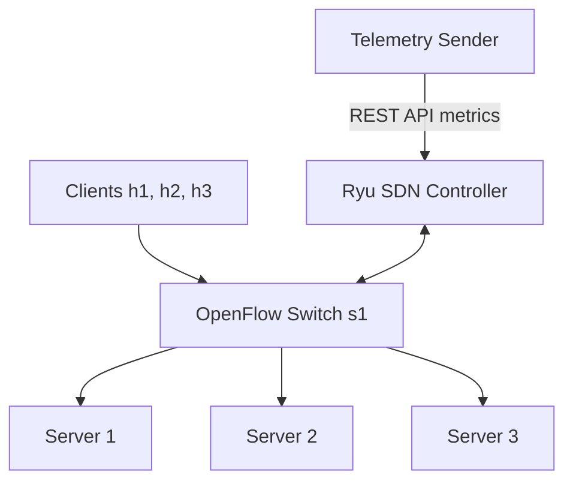
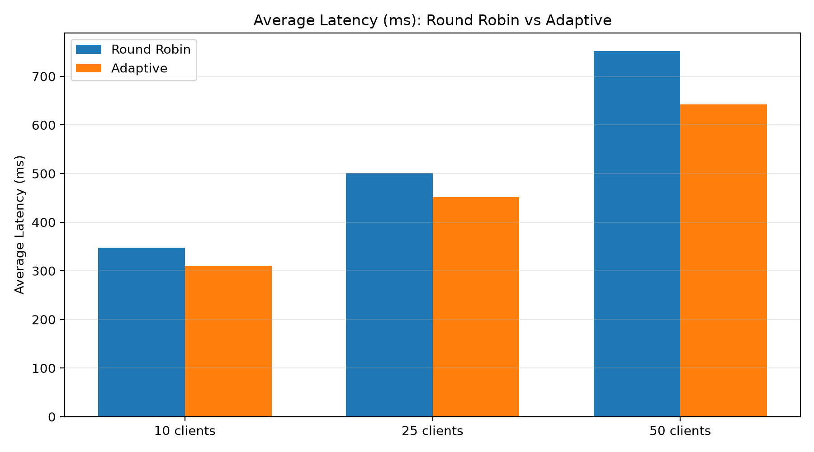
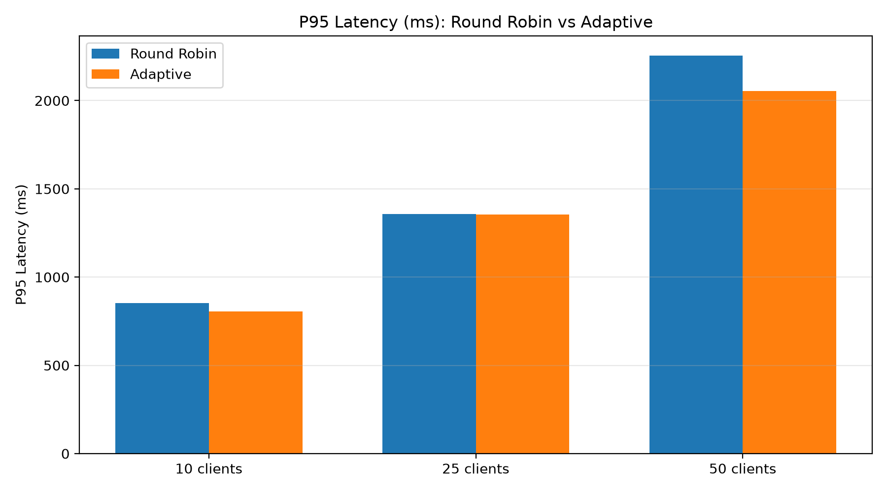
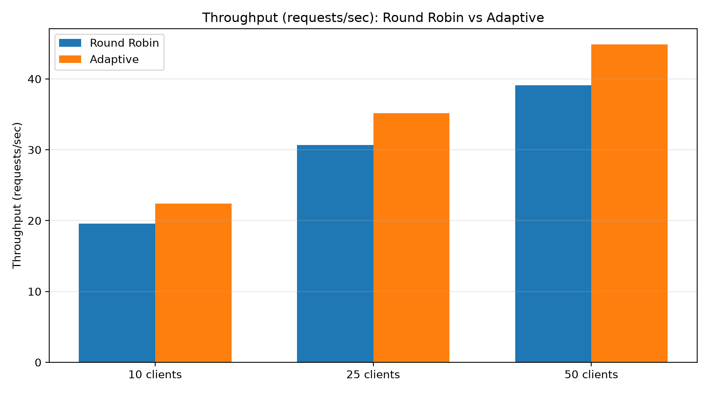
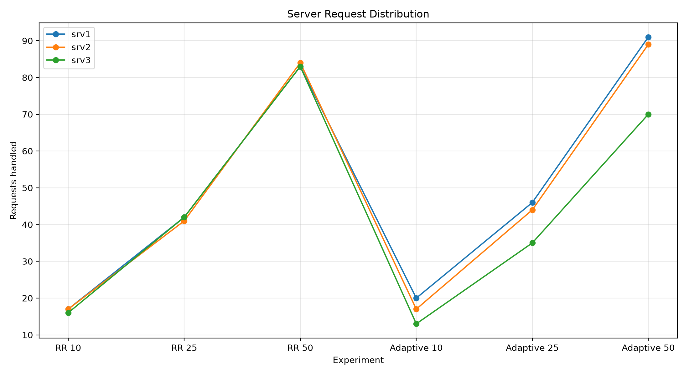

# SDN-Based Adaptive Load Balancing

## Project Overview

This project implements an SDN-based adaptive load balancing system using TCP socket programming, Mininet, Open vSwitch and the Ryu SDN controller.

The system distributes incoming TCP client connections across multiple application servers using two strategies:

- **Round Robin:** Distributes connections sequentially across available servers.
- **Adaptive Load Balancing:** Selects servers based on measured server load and network conditions.

The system also supports server failure detection, traffic rerouting and server recovery.

## System Architecture

The project consists of:

- Three TCP clients: h1, h2 and h3.
- One OpenFlow switch: s1.
- Three TCP application servers: srv1, srv2 and srv3.
- Ryu SDN controller.
- Monitoring and telemetry module.

### Architecture Diagram



## Technologies Used

- Python 3.9.25 for the Ryu virtual environment
- Ryu 4.34
- OpenFlow 1.3
- Mininet 2.3.0
- Open vSwitch 3.7.1
- TCP socket programming
- REST API
- Matplotlib

## Project Structure

```text
SDN-Adaptive-Load-Balancing/
│
├── README.md
├── .gitignore
├── source/
│   ├── client.py
│   ├── server.py
│   ├── lb_controller.py
│   ├── topography.py
│   ├── telemetry_sender.py
│   └── plot_results.py
│
├── results/
│   ├── perf_results.jsonl
│   ├── results.jsonl
│   └── ovs_port_stats.txt
│
├── graphs/
│   ├── average_latency.png
│   ├── p95_latency.png
│   ├── throughput.png
│   └── server_distribution.png
│
└── docs/
```

## Installation and Execution

### 1. Start Ryu Controller

Create and activate the Python virtual environment:

```bash
python3.9 -m venv ~/ryu-env
source ~/ryu-env/bin/activate
```

Install Ryu:

```bash
python -m pip install --upgrade "pip<25.3" "setuptools<58" wheel
python -m pip install --no-build-isolation "ryu==4.34" "eventlet<0.30.3"
```

Start the controller:

```bash
cd source
ryu-manager --verbose lb_controller.py
```

### 2. Start Mininet Topology

Open another terminal:

```bash
cd source
sudo python3 topography.py
```

Check connectivity:

```bash
pingall
```

### 3. Start Monitoring and Telemetry

Open another terminal:

```bash
cd source
sudo python3 telemetry_sender.py --interval 1
```

The monitoring module collects server CPU, memory, latency and network metrics and sends telemetry to the controller.

### 4. Check Controller Status

```bash
curl http://127.0.0.1:8080/state
```

### 5. Run Round Robin

```bash
curl -X POST http://127.0.0.1:8080/mode \
-H "Content-Type: application/json" \
-d '{"mode":"round_robin"}'
```

From the Mininet CLI:

```bash
h1 python3 client.py --clients 20
```

### 6. Run Adaptive Load Balancing

```bash
curl -X POST http://127.0.0.1:8080/mode \
-H "Content-Type: application/json" \
-d '{"mode":"adaptive"}'
```

From Mininet:

```bash
h1 python3 client.py --clients 20
```

### 7. Server Failure Testing

Stop Server 2 from Mininet:

```bash
srv2 pkill -f "server.py --name srv2"
```

Check the controller status:

```bash
curl http://127.0.0.1:8080/state
```

The adaptive controller should detect the failed server and exclude it from new connections.

### 8. Restore Server 2

```bash
srv2 python3 /home/abhiram/adaptive_lb/server.py --name srv2 --delay 0.20 > /tmp/srv2.log 2>&1 &
```

Wait for telemetry to detect the recovered server.

## Performance Evaluation

Six experiments were conducted using 10, 25 and 50 concurrent clients, with five requests per client.

| Clients | Strategy | Average Latency (ms) | P95 Latency (ms) | Throughput (req/s) |
|---|---|---:|---:|---:|
| 10 | Round Robin | 347.7 | 853.2 | 19.56 |
| 10 | Adaptive | 310.1 | 804.7 | 22.39 |
| 25 | Round Robin | 501.0 | 1356.2 | 30.64 |
| 25 | Adaptive | 452.1 | 1354.6 | 35.14 |
| 50 | Round Robin | 751.8 | 2254.6 | 39.09 |
| 50 | Adaptive | 642.6 | 2054.6 | 44.86 |

All six experiments completed with zero failed requests.

These are single-run experimental measurements.

## Performance Graphs

### Average Latency


### P95 Latency


### Throughput


### Server Request Distribution


## Fault Tolerance

The system was tested by stopping Server 2 while Adaptive mode was active.

Observed behaviour:

1. The controller detected Server 2 as DOWN.
2. New client requests were distributed across the remaining healthy servers.
3. All 20 requests in the failure test succeeded.
4. Server 2 was restarted.
5. Telemetry detected Server 2 as UP again.
6. New client requests were distributed across all three servers again.

## Network Statistics

Open vSwitch port statistics were collected using:

```bash
sudo ovs-ofctl -O OpenFlow13 dump-ports s1
```

The collected snapshot showed zero RX/TX drops and zero RX/TX errors on the reported ports.

## Conclusion

The project demonstrates TCP socket communication integrated with a Mininet-based SDN environment.

The Ryu controller supports Round Robin and Adaptive load balancing. The monitoring module supplies server and network measurements, enabling load-aware traffic distribution and server failure handling.

The experiments showed improved throughput and lower average latency with Adaptive load balancing in the tested configurations.
